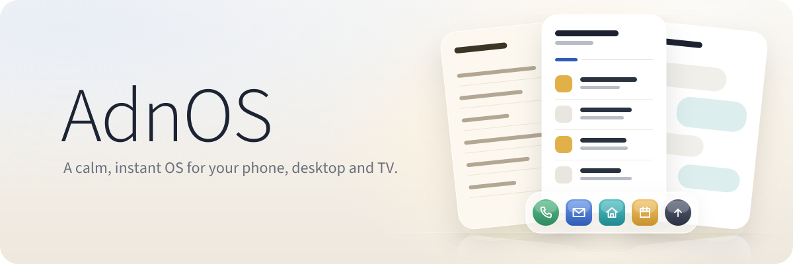
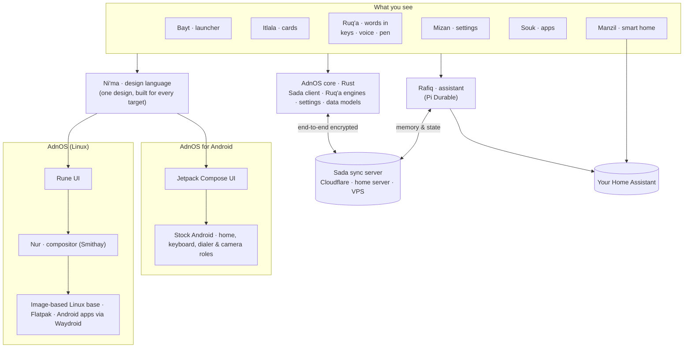

  

  
  
  
  

  <b>Instant. Calm. Yours.</b> 
  An operating system that brings back the grace of webOS, the soul of the Palm Pre, on every screen you own.

  <a href="docs/SPEC.md">Read the concept &amp; spec</a> ·
  <a href="docs/NIMA.md">Ni'ma design language</a> ·
  <a href="#the-parts">Meet the parts</a> ·
  <a href="#roadmap">Roadmap</a> ·
  <a href="CONTRIBUTING.md">Get involved</a>

---

> [!WARNING]
> **AdnOS is extremely early.** Right now this repository is a concept and a specification, not software you can install.
> Every name, design decision, technology choice and plan here **can and will change**. Nothing is stable yet.
>
> If that excites you more than it scares you, **you are exactly who we hope to meet.** The community is welcome with open arms:
> ideas, questions, sketches, critiques and code are all wanted.

## What is AdnOS?

AdnOS (عدن, *ʿAdn*, "Eden") is a free, open operating system and shell for **phones, tablets, desktops and TVs**.

It's built on one belief: computers should feel the way the best handhelds once did. You tap and the thing is just *there*. Nothing loads. The interface is quiet until you need it, and when you do, it's graceful. webOS on the Palm Pre got this right. AdnOS carries that forward on modern hardware, across all your screens, with one launcher, one design language and your data in sync everywhere.

### The webOS DNA

| | What we keep from webOS (Palm Pre, Pixi, Pre 2, Veer, Pre 3, TouchPad) |
|---|---|
| 🃏 **Cards** | Every running app is a live card you can see from above, shuffle, stack and flick away. **Itlala**. |
| 👆 **The gesture area** | Swipe up to see your cards, swipe back to go back, and a soft light that answers your touch. |
| 🚀 **Launcher & quick launch** | An honest grid of apps, a quick-launch bar, and the Wave: swipe up and hold, slide to an app, let go. **Bayt**, the same on every device. |
| 🔍 **Just Type** | Start typing anywhere to search, launch or act. |
| 🔔 **Notifications that don't interrupt** | A slim bar at the bottom of the screen that waits for you, never a pop-up in your face. |
| 🔗 **Synergy** | All your accounts merged into one calendar, one contact list, one inbox. **Sada** carries it everywhere. |
| ⚡ **Instant** | No splash screens and no spinners on the core experience. Wake it and it's ready. |
| 🎨 **The design language** | webOS behavior, iOS physics, and the light of Islamic architecture: geometry that is calm from afar and intricate up close, light that follows the sun. **[Ni'ma](docs/NIMA.md)**. |

## Two editions, one experience

Pick the one that fits your life. Both share the same launcher, design, handwriting and sync.

| | **AdnOS** | **AdnOS for Android** |
|---|---|---|
| **What it is** | The full operating system | The AdnOS experience on a stock Android phone or Google TV device |
| **Under the hood** | Linux with an image-based system and atomic updates | The phone's own, unmodified Android |
| **Runs on** | Desktops, laptops, TV boxes, tablets and phones with mainline Linux support | Modern Android phones and Android TV / Google TV devices |
| **Android apps** | Through an isolated compatibility layer | Natively |
| **Tap-to-pay & banking** | Use a watch or your card | ✅ Everything works |
| **Netflix & co. in 4K HDR / Dolby Atmos** | Not possible on Linux today (DRM) | ✅ Everything works |
| **Choose it if…** | You want lighter, more open, and fully yours | You need every app and payment to just work |

## The parts

Each part has an Arabic name chosen to be easy to say in English.

| Part | Name | Say it | Meaning | What it does |
|---|---|---|---|---|
| Operating system | **AdnOS** | "Aden OS" | عدن · Eden | The whole thing |
| Launcher | **Bayt** | "bite" | بيت · home | The app grid and home screen, the same on phone, tablet, desktop and TV |
| Card view | **Itlala** | it-LAH-la | إطلالة · overlook | A bird's-eye view of everything you have open |
| Input | **Ruq'a** | ROO-ka | رقعة · the everyday Arabic script | Every way you put words in: keyboard, voice-to-text, pen and handwriting, and one day sign-language gestures |
| Design language & UI kit | **Ni'ma** | NEE-mah | نعمة · grace | How AdnOS looks, moves and feels |
| App library | **Souk** | "sook" | سوق · market | Find and install apps |
| Settings | **Mizan** | mee-ZAHN | ميزان · balance | Everything you can change |
| Compositor | **Nur** | "noor" | نور · light | Puts every pixel on screen |
| Sync | **Sada** | SAH-da | صدى · echo | What you do on one device echoes on the others |
| Assistant | **Rafiq** | ra-FEEK | رفيق · companion | A voice assistant for the whole family that follows you from room to room |
| Smart home | **Manzil** | MAN-zil | منزل · house | A beautiful front end for your existing Home Assistant |

## Rafiq: an assistant for the whole family

The assistant Siri was supposed to be: someone you can actually talk to.

- 🗣️ **Natural, live conversation.** Speech in, speech out, in real time. Interrupt it, change your mind, keep talking.
- 👨‍👩‍👧 **Knows who's speaking.** Each family member enrolls their voice, and Rafiq answers with their calendar, their reminders, their music.
- 🧒 **Kid-safe by default.** When it hears a child, or anyone it doesn't recognize, it switches to family-safe answers, limits purchases and smart-home controls, and follows the rules the parents set.
- 🚶 **Follows you through your home and beyond.** Start in the kitchen on a wall panel, keep going in the living room on the TV, and finish on your phone or watch as you leave. Same conversation, no repeating yourself.
- 🧠 **Remembers, everywhere.** Rafiq's memory and state travel with you through Sada, so it works just as well away from home.
- 🏠 **Runs your home.** Rafiq talks to Home Assistant, so "Goodnight" can dim the lights, lock the doors and set the alarm.

Rafiq is built on [Pi Durable](https://developers.cloudflare.com/agents/harnesses/pi/), an open-source agent harness
whose conversations survive crashes and pick up from their last checkpoint on any machine. It runs on Cloudflare
Durable Objects, the same foundation as Sada.

## Manzil: your home, beautifully

**We're not building a smart-home hub.** [Home Assistant](https://www.home-assistant.io) already solved that, and
solved it well. Manzil is a front end: a calm, beautiful layer on top of the Home Assistant you already run.

- 🎨 **Looks like a modern home app, feels like webOS.** Rooms, scenes and devices as soft, glanceable cards, with the
  gesture area, the Wave and the card view, drawn in Ni'ma.
- 📱🖥️📺 **Everywhere.** A phone app, a wall-mounted panel, widgets in Bayt, and a 10-foot view on the TV.
- 🔌 **Just connect.** Point it at your Home Assistant, sign in, and your rooms appear. No hub of ours, no cloud of ours.

## How it fits together

- **One core, two native front ends.** All logic lives in a shared Rust core. On Linux the interface is drawn with [Rune](https://github.com/anomalyco/rune) inside our own compositor, **Nur**, built on [Smithay](https://github.com/Smithay/smithay). On Android it uses Jetpack Compose and Android's own system roles.
- **Design once, build everywhere.** A screen such as the Ruq'a keyboard is designed once in Ni'ma's design format, previewed live in a browser, and generated for Rune and Compose.
- **Your sync, your server.** Sada is a tiny, end-to-end encrypted sync relay that you deploy to your own Cloudflare account, home server or VPS. The server stores only data it can't read.
- **Standing on proven ground.** The full OS follows a pattern that already works: a pinned, image-based Linux base, an atomic OSTree update system, Flatpak apps and an isolated Android runtime, all composed into one signed image.

The full reasoning is in **[docs/SPEC.md](docs/SPEC.md)**.

## Roadmap

> Every phase below is a plan, not a promise.

- [x] **Phase 0: Concept.** Name, principles, architecture and this spec.
- [ ] **Phase 1: Foundations.** The Rust core, the Ni'ma design tokens, a first Sada server on Cloudflare Workers, and **Manzil mockups**.
- [ ] **Phase 1.5: Manzil.** A working Home Assistant front end on phone, wall panel and TV.
- [ ] **Phase 2: AdnOS for Android.** Bayt as a home-screen app, plus the Ruq'a keyboard, running daily on real phones.
- [ ] **Phase 3: The shell on Linux.** Nur and Bayt running on a desktop, first nested inside an existing desktop, then as the session itself.
- [ ] **Phase 4: Design once.** A browser studio that previews Ni'ma designs live and builds them for Rune and Compose.
- [ ] **Phase 5: The OS image.** A signed, atomic AdnOS image for desktops and TVs, with Souk and Android app support.
- [ ] **Phase 5.5: Rafiq.** Voice conversation, voice recognition, family profiles and kid-safe mode, following you across devices.
- [ ] **Phase 6: Phones on Linux.** A phone image tested in a virtual phone first, then on devices with mainline Linux support.

## Status

**Concept stage.** There is no code yet. The specification is the product right now, and it's the best place to help:
question it, poke holes in it, propose better ideas.

## Get involved

AdnOS is meant to be built in the open, with everyone who loves calm, fast, beautiful software.

- 💬 **Talk:** open an [issue](../../issues) with an idea, a question or a disagreement.
- 📐 **Design:** sketches of Bayt, Itlala and Ruq'a are as valuable as code right now.
- 🛠️ **Build:** see [CONTRIBUTING.md](CONTRIBUTING.md).

## Standing on the shoulders of

AdnOS is inspired by, and hopes to learn from and contribute back to, these projects:

- **webOS** and the **Palm Pre**, for showing how graceful a small computer can feel.
- **[PopkaPhone](https://github.com/PopaSpinka)** and **[PopkaStudio](https://github.com/PopaSpinka/PopkaStudio)**, for proving one person can build a phone shell from scratch and preview it live in a browser.
- **[Luma](https://github.com/SimplyLuma/luma)**, for its model of one OS across every screen, built on an image-based Linux base.
- **[Home Assistant](https://www.home-assistant.io)**, for making the smart home open, local and hackable.
- **[Pi](https://developers.cloudflare.com/agents/harnesses/pi/)**, for a durable, open agent harness.
- **[Rune](https://github.com/anomalyco/rune)**, **[Smithay](https://github.com/Smithay/smithay)**, **[Waydroid](https://github.com/waydroid/waydroid)**, **[Flatpak](https://flatpak.org)** and **[Fedora Atomic](https://fedoraproject.org/atomic-desktops/)**.

All product names are the property of their respective owners. AdnOS is not affiliated with any of them.

## License

- **Code:** [Apache License 2.0](LICENSE)
- **Documentation:** [CC BY 4.0](LICENSES/CC-BY-4.0.txt)
- **Artwork & media:** [CC BY-SA 4.0](LICENSES/CC-BY-SA-4.0.txt)

Third-party material keeps its own license. Details are in [LICENSING.md](LICENSING.md).
